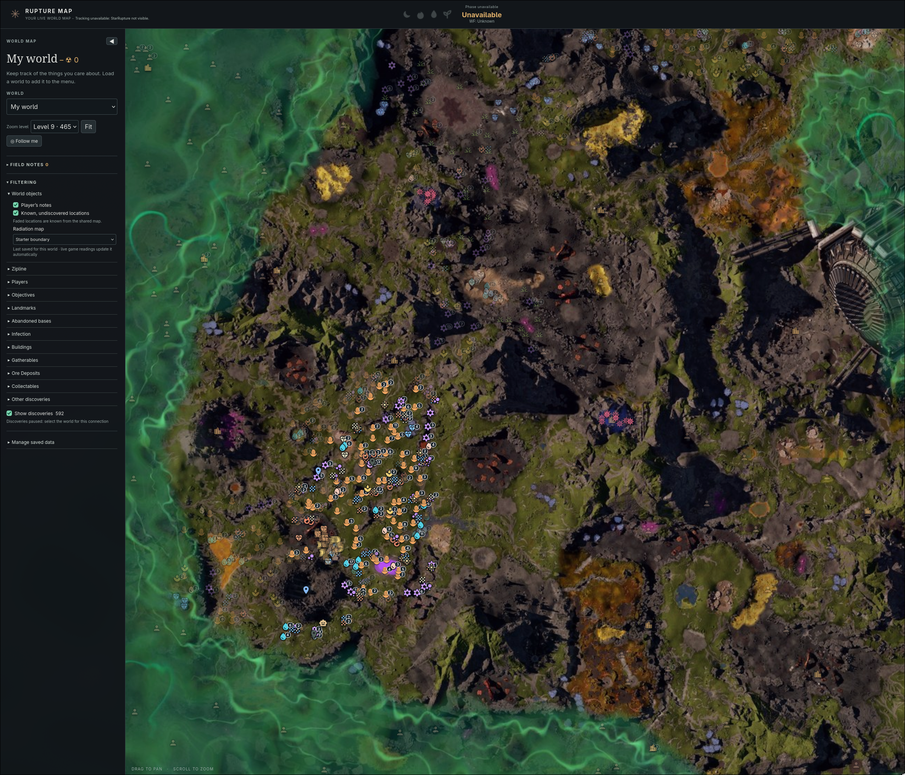

# Rupture Map

**Version 1.0** · A private, local browser companion for **StarRupture**. Follow your position and discoveries on a second screen, keep your own notes, and explore a shared view of places you've found across worlds. The tracker reads game data; it does not change the game or its map.



## Get started

On Linux with Steam/Proton and Python 3:

```bash
git clone https://github.com/daimyo314/rupture-map.git
cd rupture-map
python3 server.py
```

Open **[http://127.0.0.1:8765/](http://127.0.0.1:8765/)** on your second screen. Keep the terminal open while using the map; press Ctrl+C to stop the server. If the port is occupied, run `python3 server.py --port 8766` and open the matching address.

Live tracking is currently supported for **Linux/Proton, Steam build 26781824 / CL127004**, with the game installed at `/legames/steamapps/common/StarRupture`. Other installations require path changes in `server.py`. The game and tracker need to run as the same user with permission to read the process. A game update can invalidate offsets. The server uses Python's standard library.

**Windows:** The manual map and notes can be tried, but live tracking has not been ported or tested. See [Windows adoption and agent handoff](WINDOWS-ADOPTION.md) for setup, limitations, and instructions to give a coding agent.

## Features

- **Live position and orientation:** Follow your location and facing while panning or choosing a numbered zoom level. Connected multiplayer clients can show other players and their facing where available; choose one player to draw a connection line. Replicated updates can be delayed.
- **Worlds and radiation:** Keep discovered multiplayer server worlds separate, select a world in the sidebar, and show the supported radiation boundary for its saved state. Different single-player saves are not automatically distinguished.
- **Discoveries and filtering:** Record nearby gatherables, ore and mineral objects, collectables, landmarks, standalone buildings, zip-rail routes, abandoned bases, and infection cysts. Expand individual filter groups and select the types you want to see. Some objects may only be reported while loaded or nearby.
- **Resource groups and shared knowledge:** Nearby icons of the same type combine as you zoom out and show a count. Known locations from another world appear faded when enabled; player-built structures and world-specific progress stay separate.
- **Objectives and bases:** Show available objectives and step progress. Hover over abandoned bases for recorded foundable, blueprint, story-item, and cyst completion counts. Objective steps are not necessarily mapped to confirmed destinations.
- **Infection and death drops:** A purple glow approximates places visited while the tumor tracker is active. Skull markers show currently loaded player death drops and may disappear when looted or unloaded.
- **Cycle forecast:** See the reported timer phase, countdown to the next phase, wave frequency, and replicated fadeout, water, and growback states. Visual alerts reflect the reported phase and fadeout. The Moon Phase indicator is inferred from growback; it is not independently confirmed. Cave markers glow during that inferred phase.
- **Private notes and labels:** Add your own markers and notes, name Habitats locally, and collapse the sidebar or Field Notes section to make room for the map.

## Storage and limitations

Worlds, discoveries, shared locations and notes are stored in the current browser profile's IndexedDB for the current address and port. Expand **Field Notes** and use **Export** before clearing browser data, changing profiles or ports, or moving computers. **Import** adds worlds and merges shared locations. The server listens on localhost and the app makes no external network requests. Multiplayer server associations use a local hash of the server address; `server-worlds.json` is not committed.

Live data depends on what the game client loads or replicates. Remembered locations may be stale or depleted; radiation artwork is not a guarantee of safety. Infection-area clearing is a HUD-based heuristic rather than a verified boundary. Position alignment has been checked near the landing area, not exhaustively across the map.

The terrain images are assembled from game assets. The ore and landmark coordinate catalogs are derived from [MapExtension_Plugin](https://github.com/Mralexandresys/MapExtension_Plugin); see [ORE-CATALOG-LICENSE.txt](ORE-CATALOG-LICENSE.txt). Bundled Google Material Icons are covered by [their license](assets/MATERIAL-ICONS-LICENSE.txt).
